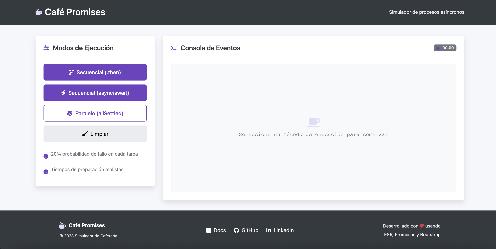

# Simulador de Cafetería con Promesas JavaScript

Un simulador interactivo que demuestra diferentes métodos para manejar operaciones asíncronas en JavaScript mediante la preparación de pedidos en una cafetería virtual.

## Características principales

- Simulación realista de tiempos de preparación
- Tres métodos distintos para manejar asincronía:
  - Encadenamiento con `.then()` y `.catch()`
  - Sintaxis `async/await` con `try/catch`
  - Ejecución paralela con `Promise.allSettled()`
- Probabilidad configurable de fallos (20% por defecto)
- Interfaz intuitiva con consola de eventos en tiempo real
- Resumen detallado del pedido
- Diseño responsive que funciona en móviles y desktop

## Requisitos

- Navegador web moderno (Chrome, Firefox, Edge o Safari de versiones recientes)
- Editor de código (opcional para modificaciones)

## Instalación

1. Descargar el repositorio como archivo ZIP o clonarlo usando Git
2. Extraer los archivos en una carpeta local
3. Abrir el archivo `index.html` en tu navegador preferido

Para desarrolladores:
- No se requieren dependencias adicionales
- El proyecto usa Bootstrap y Font Awesome a través de CDN

## Cómo utilizar

1. **Iniciar simulación**:
  - Seleccionar uno de los tres métodos disponibles:
    - *Secuencial (.then)*: Muestra el encadenamiento tradicional de promesas
    - *Secuencial (async/await)*: Demuestra la sintaxis moderna
    - *Paralelo*: Ejecuta todas las tareas simultáneamente

2. **Ver resultados**:
  - La consola muestra el progreso en tiempo real
  - Los mensajes indican éxitos y fallos durante la preparación
  - Los tiempos de ejecución se muestran para cada item

3. **Analizar resultados**:
  - El resumen final muestra el estado de cada producto
  - Se indican claramente los fallos y sus causas
  - Los tiempos totales son visibles para comparación

4. **Reiniciar**:
  - Usar el botón "Limpiar" para comenzar una nueva simulación

## Estructura del proyecto

- `index.html`: Contiene la estructura principal de la aplicación
- `styles.css`: Todos los estilos visuales
- `app.js`: La lógica principal de la aplicación

## Tecnologías utilizadas

- HTML5 (estructura semántica)
- CSS3 (diseño responsive y animaciones)
- JavaScript ES6+ (promesas, async/await)
- Bootstrap 5 (diseño y componentes UI)
- Font Awesome (iconos profesionales)

## Personalización

Para modificar la aplicación:
1. Cambiar tiempos de preparación: Editar los valores en las funciones de `app.js`
2. Ajustar probabilidad de fallo: Modificar el 0.2 en las funciones de preparación
3. Añadir nuevos items: Crear nuevas funciones similares a las existentes

## Autor

**Magdalena Inalaf G.**  
Desarrolladora Full Stack especializada en JavaScript y tecnologías web modernas.

### Contacto
- Sitio web: [https://inalaf.ca](https://inalaf.ca)
- GitHub: [MagdaIG](https://github.com/MagdaIG)
- LinkedIn: [minalaf](https://www.linkedin.com/in/minalaf/)
- Email: contacto@inalaf.ca

## Agradecimientos

Este proyecto fue desarrollado como demostración educativa de:
- Manejo de operaciones asíncronas en JavaScript
- Patrones modernos de programación con promesas
- Diseño de interfaces intuitivas

## Licencia

Este proyecto está licenciado bajo la licencia MIT - ver el archivo [LICENSE](LICENSE) para más detalles.

---

Desarrollado con ❤️ usando ES6, Promesas y Bootstrap  
© 2023 Todos los derechos reservados
